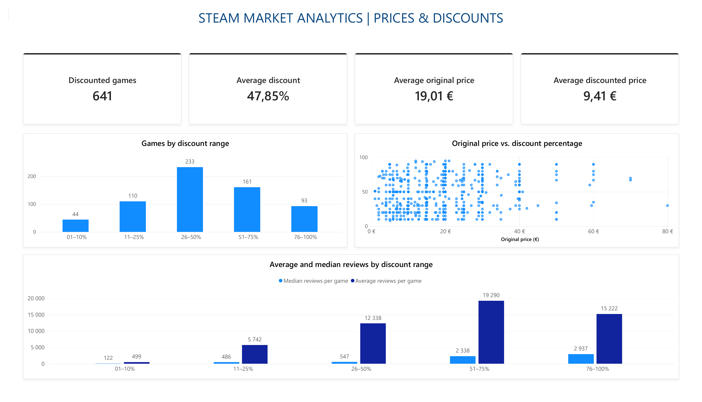
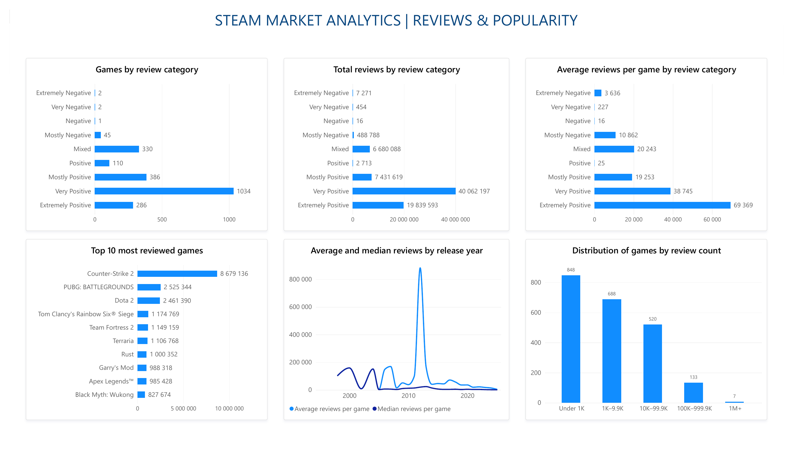

# Steam Market Analytics

A data analytics and engineering portfolio project exploring a snapshot of Steam game listings. It demonstrates a workflow from raw data inspection and quality checks through Python-based transformation, PostgreSQL data modeling, SQL analysis, and an interactive Power BI dashboard.

The goal is to turn raw game data into structured, validated datasets and investigate game prices, discounts, review activity, genres, and tags.

## Project goals

- Inspect the dataset and assess data quality.
- Clean, transform, and validate records with Python and Pandas.
- Design staging and analytical schemas in PostgreSQL.
- Automate ingestion and the population of normalized tables.
- Explore the data through analytical SQL queries.
- Present findings in Power BI using DAX measures and interactive filters.
- Document conclusions, assumptions, and limitations.

## Tech stack

| Technology | Purpose |
| --- | --- |
| Python | Data processing and ETL orchestration |
| Pandas | Cleaning, transformation, and validation |
| PostgreSQL | Relational data storage |
| SQL | Database modeling, normalization, and analysis |
| Power BI | Interactive reporting and visualization |
| DAX | Measures and analytical calculations |
| pytest | Automated Python tests |
| Git & GitHub | Version control and project documentation |

## Project structure

```text
steam-game-analisys/
├── data/
│   ├── raw/                      # Source CSV (not tracked)
│   └── processed/                # Optional CSV outputs (not tracked)
├── docs/
│   └── analytical_findings.md
├── src/
│   ├── cleaning.py
│   ├── inspect_data.py
│   ├── load_analytics_data.py
│   ├── load_raw_data.py
│   ├── profile_data.py
│   ├── run_etl.py
│   ├── run_pipeline.py
│   └── validation.py
├── sql/
│   ├── 01_create_raw_schema.sql
│   ├── 02_create_analytics_schema.sql
│   ├── 03_create_normalized_schema.sql
│   ├── 04_populate_normalized_tables.sql
│   ├── 05_drop_denormalized_genre_tag_columns.sql
│   └── analysis/
│       ├── 01_dataset_overview.sql
│       ├── 02_price_vs_reviews.sql
│       ├── 03_reviews_by_rating.sql
│       ├── 04_discount_consistency.sql
│       ├── 05_discount_distribution.sql
│       ├── 06_genre_performance.sql
│       ├── 07_tag_performance.sql
│       ├── 08_genre_tag_relationship.sql
│       ├── 09_tag_count_vs_popularity.sql
│       └── 10_release_year_vs_popularity.sql
├── tests/
│   ├── test_cleaning.py
│   ├── test_pipeline.py
│   ├── test_profile_data.py
│   └── test_validation.py
├── reports/
│   ├── screenshots/
│   │   ├── overview.png
│   │   ├── prices_discounts.png
│   │   ├── reviews_popularity.png
│   │   └── genres_tags.png
│   ├── steam_market_analysis.pbix
│   └── steam_market_analysis.pdf
├── .gitignore
├── README.md
└── requirements.txt
```

The source and processed CSV files are excluded from version control. Local PostgreSQL credentials belong in an untracked `.env` file.

## Data source

The project uses a publicly available [Steam Games Dataset on Zenodo](https://zenodo.org/records/15121027).

The original dataset is **not** included in this repository. Results reflect a collected snapshot, **not** current Steam prices, discounts, or review counts.

## Data processing and database design

The database separates original source records from analytical data:

1. **Raw inspection:** examine columns, types, missing values, and unusual records.
2. **Staging ingestion:** load the original CSV into `staging.steam_games_raw`.
3. **Cleaning and validation:** use Python and Pandas to normalize fields and check data quality.
4. **Analytical ingestion:** load transformed records into `analytics.steam_items`.
5. **Normalization:** populate genre/tag dictionaries and their many-to-many relationship tables.
6. **SQL analysis:** investigate pricing, discounts, reviews, release years, genres, and tags.
7. **Visualization:** refresh the Power BI report connected to PostgreSQL.

The analytical model includes `analytics.steam_items`, `analytics.genres`, `analytics.tags`, `analytics.item_genres`, and `analytics.item_tags`. Relationship tables allow one game to have multiple genres and tags.

## Running the project

### Prerequisites

- Python with dependencies from `requirements.txt`.
- A running PostgreSQL instance and a dedicated project database.
- The source dataset saved as `data/raw/steam-games.csv`.
- A `.env` file in the project root with database connection settings.

Install dependencies from the project root:

```bash
pip install -r requirements.txt
```

Create the `.env` file with your own PostgreSQL credentials:

```dotenv
DB_HOST=localhost
DB_PORT=5432
DB_NAME=steam_market_analysis
DB_USER=your_database_user
DB_PASSWORD=your_database_password
```

Before the first ETL run, create the database objects by executing these scripts **in order** against your project database:

1. `sql/01_create_raw_schema.sql`
2. `sql/02_create_analytics_schema.sql`
3. `sql/03_create_normalized_schema.sql`

These are initial setup scripts; they should not be rerun indiscriminately against an existing database. The optional `05_drop_denormalized_genre_tag_columns.sql` is a schema migration, **not** part of the regular ETL run.

### Option A: Clean and validate a CSV without PostgreSQL

```bash
python -m src.run_pipeline
```

This standalone command creates:

- `data/processed/steam-games-cleaned.csv` (only when validation passes)
- `data/processed/validation-report.csv`

Use this when you only need the cleaned dataset and its validation report.

### Option B: Run the complete PostgreSQL ETL

```bash
python -m src.run_etl
```

This command:

1. Loads the original CSV into staging.
2. Cleans and validates staging data.
3. Loads the analytical game records.
4. Populates genre/tag dictionaries and relationship tables using `sql/04_populate_normalized_tables.sql`.
5. Verifies record counts and that relationship tables are populated.

**Important:** The full ETL replaces records in the staging and analytical tables. It uses separate transactions for its stages, so an error can leave a partially refreshed database. Run it only against a dedicated project database, keep backups of data you need, and rerun after fixing the underlying error.

The ETL prepares the data for reporting; it does **not** automatically refresh Power BI. Open `reports/steam_market_analysis.pbix` and refresh the dataset in Power BI Desktop after an ETL run.

### Run automated tests

```bash
python -m pytest -v
```

### Example validation outcome

The latest local ETL run processed **2,927** records and completed with **6 PASS, 3 WARN, and 0 FAIL** checks. The three warnings identify limitations to investigate rather than silently altering the underlying data:

- 560 records with missing prices.
- 731 records with missing review counts.
- 7 unusually distant future release dates (2050 or later).

The run also populated 47 genre names, 393 tags, 6,007 game–genre relationships, and 14,182 game–tag relationships.

## Power BI dashboard

The Power BI report contains four interactive pages. It uses DAX measures and filters to explore pricing, reviews, genres, and tags.

### 1. Overview


Provides the dataset overview: number of games, review coverage, average and median prices, release-year distribution, leading genres, and rankings by review count. Includes genre and release-year filters.

### 2. Prices & discounts



Explores the number of discounted games, average discount, original and discounted prices, discount ranges, and the relationship between discounts and review activity.

### 3. Reviews & popularity



Compares review categories, total and average reviews, the most-reviewed games, review activity across release years, and the distribution of review counts.

### 4. Genres & tags


Examines tag frequency, tags ranked by median review count, popular tags within a selected genre, and review activity by tag count.

**[View the complete dashboard (PDF)](reports/steam_market_analysis.pdf)**

## Key analytical findings

The observations below describe the analyzed snapshot of **2,927 Steam items**.

### Price distribution

- 2,367 items have a recorded price, while 560 have missing prices (19.13%).
- 188 items have a listed price of €0.
- Average recorded price: **€15.89**.
- Median recorded price: **€10.35**.

The average exceeds the median, suggesting that higher-priced games influence the mean.

### Review data

- 2,196 items have a recorded review count; 731 do not.
- **Very Positive** is the most common review category, with 1,034 games.
- **Counter-Strike 2** has the highest recorded review count: **8,679,136**.

A small number of highly reviewed titles strongly influence aggregate statistics.

### Discount analysis

- 641 items have a recorded discount.
- Average discount: **47.85%**.
- Average original price among discounted games: **€19.01**.
- Average price after discount: **€9.41**.
- The 26–50% discount range is the most common: 233 games (36.35% of discounted items).
- Discounts above 50% account for approximately 39.63% of discounted items.
- The average absolute difference between recorded and calculated discounts is 0.05 percentage points, with no checked item exceeding the 1-percentage-point validation tolerance.

### Discounts and review activity

- The 51–75% discount range has the highest **average** review count.
- The 76–100% discount range has the highest **median** review count.
- Large gaps between means and medians indicate the influence of outliers.

These are descriptive associations; they do **not** show that larger discounts cause more reviews.

### Genres and tags

- **Simulación** is the most frequently assigned tag (740 games).
- **Acción** follows with 604 games, and **Estrategia** with 515.
- **Robos** has the highest median review count in the displayed tag ranking.
- Genre filtering reveals how tag frequencies vary within different game categories.

Frequently used tags are not necessarily associated with the highest review counts. Tag rankings should be interpreted carefully when groups contain few games.

For extended interpretations and limitations, see **[Detailed analytical findings](docs/analytical_findings.md)**.

## Project status

**Core workflow and dashboard completed; further reproducibility and validation improvements are possible.**

Completed:

- Raw data profiling, cleaning, and automated validation checks.
- PostgreSQL staging and analytical schemas.
- Python ingestion and a single-command ETL runner.
- Normalized genre/tag tables and analytical SQL queries.
- Automated Python tests.
- Four-page interactive Power BI dashboard, report PDF, and previews.
- Written analytical findings and data limitations.

Potential next steps:

- Test a clean installation and database rebuild from scratch.
- Strengthen end-to-end transaction handling and failure recovery.
- Expand data-quality and integration tests.
- Investigate statistical relationships and additional business questions.
- Consider CI checks (e.g., GitHub Actions).

## Data limitations

- The data is a historical snapshot, not a live view of the Steam market.
- The sample may not represent the entire Steam catalog.
- Missing values are retained and are not automatically treated as zero.
- Review and discount data may be incomplete.
- Review counts are not equivalent to sales, revenue, or active players.
- A game can belong to multiple genres and have multiple tags.
- Original release-date values can be ambiguous or unusually far in the future.
- Observed relationships are not evidence of causation.
