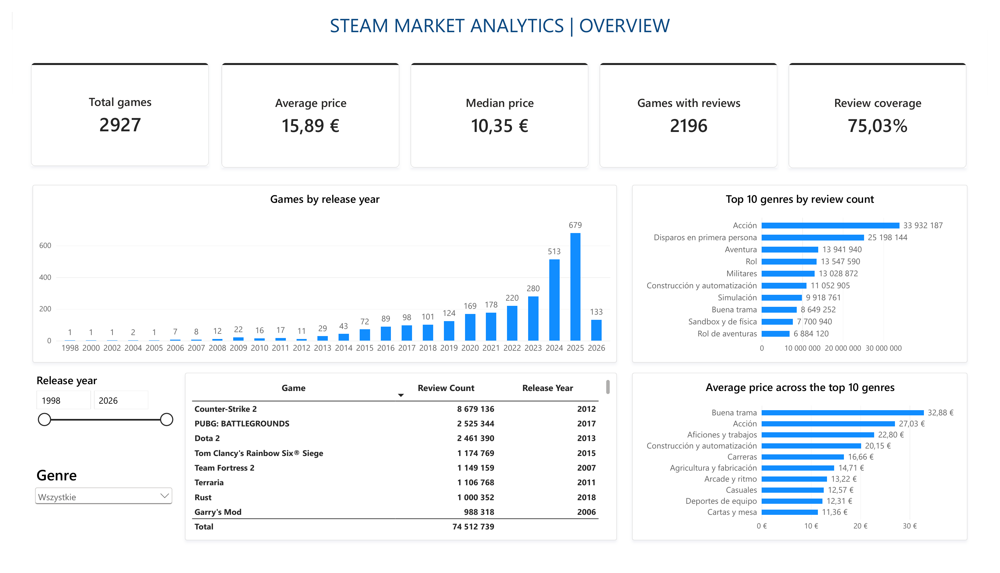
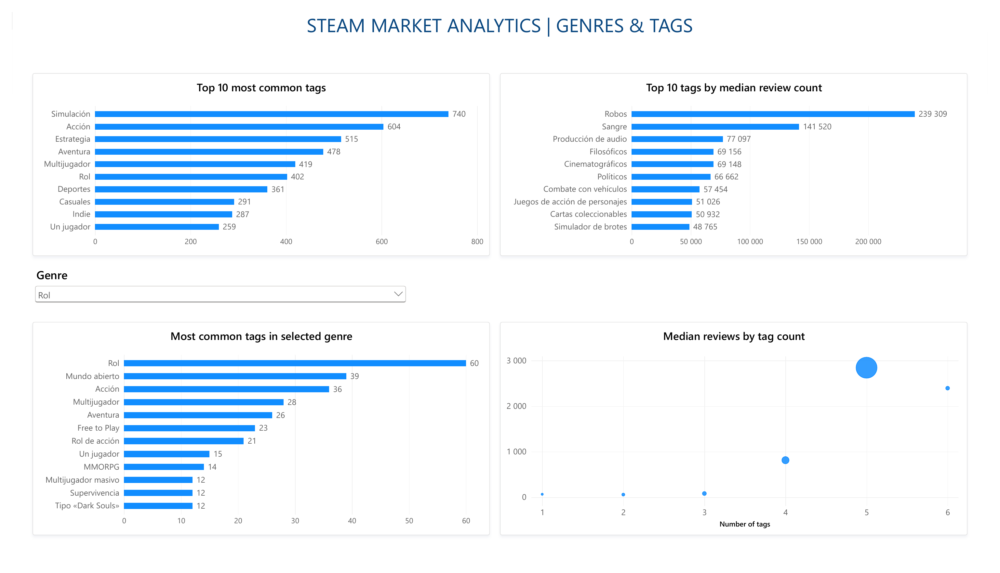

# Steam Market Analytics

A data analytics and engineering portfolio project focused on exploring video game data from Steam.

The project demonstrates an end-to-end analytical workflow, covering raw data inspection, data cleaning, database design, data ingestion, SQL analysis, and interactive visualization using Power BI.

The main objective is to transform raw game data into structured, reliable datasets and derive meaningful insights about game prices, discounts, genres, tags, and review activity.

## Project goals

- Inspect and assess raw dataset quality.
- Clean, transform, and validate data using Python and Pandas.
- Design and implement a relational data model in PostgreSQL.
- Build a structured data pipeline for database ingestion.
- Perform analytical queries using SQL.
- Develop interactive dashboards using Power BI and DAX.
- Explore statistical relationships and trends in the data.
- Document analytical findings and data limitations.

## Tech stack

| Technology | Purpose |
|---|---|
| Python | Data processing and ingestion |
| Pandas | Data cleaning and transformation |
| PostgreSQL | Relational database and data storage |
| SQL | Data modeling and analytical queries |
| Power BI | Interactive dashboards and visualization |
| DAX | Measures and analytical calculations |
| Git & GitHub | Version control and project management |

## Project structure

```text
steam-game-analisys/
├── data/
│   ├── raw/
│   └── processed/
├── docs/
│   └── analytical_findings.md
├── src/
│   └── inspect_data.py
├── sql/
│   ├── 01_create_raw_schema.sql
│   ├── 02_create_analytics_schema.sql
│   ├── 03_create_normalized_schema.sql
│   ├── 04_populate_normalized_tables.sql
│   └── analysis/
├── reports/
│   └── steam_market_analysis.pbix
├── .gitignore
├── README.md
└── requirements.txt
```

The `data/raw/` and `data/processed/` directories are excluded from version control where appropriate.

## Data source

The project uses a publicly available Steam games dataset.

Source: [Steam Games Dataset – Zenodo](https://zenodo.org/records/15121027)

The dataset is not included in this repository. Its original snapshot is used for analytical purposes.

The results describe the collected dataset and should not be interpreted as current Steam prices, discounts, or review counts.

## Data processing and database design

The data workflow consists of several stages:

1. **Raw data inspection** – examining dataset structure, data types, missing values, and inconsistencies.
2. **Data cleaning** – processing and validating raw data using Python and Pandas.
3. **Data ingestion** – loading processed data into PostgreSQL.
4. **Database modeling** – separating raw and analytical data into dedicated schemas.
5. **Normalization** – extracting genres and tags into relational tables to support more flexible analysis.
6. **SQL analysis** – investigating prices, discounts, reviews, genres, and other game attributes.
7. **Visualization** – connecting PostgreSQL to Power BI and building interactive reports.

The analytical database includes normalized tables for Steam items, genres, tags, and their relationships.

This structure supports analysis of many-to-many relationships between games, genres, and tags.

## Power BI dashboard

The interactive Power BI dashboard consists of four pages, each focusing on a different aspect of the dataset.

The report uses DAX measures, calculated columns, and interactive filters to support data exploration.


## Dashboard preview

The Power BI dashboard consists of four interactive pages covering game prices, discounts, reviews, genres, and tags.

### 1. Overview



### 2. Prices & discounts


### 3. Reviews & popularity


### 4. Genres & tags



### Full report

[View the complete dashboard (PDF)](reports/steam_market_analysis.pdf)


### 1. Overview

Provides a general overview of the dataset, game prices, release years, and genre-level statistics.

Visualizations include:

- Total number of games.
- Number of games with review data.
- Review data coverage.
- Average and median game prices.
- Distribution of games by release year.
- Top genres by total review count.
- Average game prices by genre.
- Ranking of games by review count.
- Interactive genre and release year filters.

### 2. Pricing & discounts

Focuses on game pricing patterns, discount distribution, and review activity across discount ranges.

Visualizations include:

- Number of discounted games.
- Average discount percentage.
- Average original price of discounted games.
- Average price after discount.
- Distribution of games across discount ranges.
- Comparison of average and median review counts by discount range.
- Scatter plot showing the relationship between original price and discount percentage.

### 3. Reviews & popularity

Explores review activity, popularity distribution, and differences between review categories.

Visualizations include:

- Number of games by review category.
- Total review count by category.
- Average review count by category.
- Top 10 games by review count.
- Average and median review counts by release year.
- Distribution of games across review-count ranges.

### 4. Genres & tags

Investigates tag frequency, review-based popularity, and relationships between genres and tags.

Visualizations include:

- Top 10 most frequently assigned tags.
- Top 10 tags ranked by median review count.
- Interactive ranking of tags within a selected genre.
- Median review count by number of assigned tags.
- Genre-based filtering.

## Key analytical findings

The following findings are based on the analyzed dataset snapshot containing 2,927 Steam store items.

### Price distribution

- Total dataset size: 2,927 items.
- 2,367 items have a recorded price.
- 560 items (19.13%) have missing prices.
- 188 items have a listed price of €0.
- Average recorded price: €15.89.
- Median recorded price: €10.35.

The difference between the average and median suggests that higher-priced games influence the overall average.

### Review data

- 2,196 items have a recorded review count.
- 731 items have missing review counts.
- The most common review category is Very Positive, containing 1,034 games.
- Counter-Strike 2 has the highest recorded review count, with 8,679,136 reviews.
- Review counts are unevenly distributed, with a relatively small number of highly reviewed games influencing aggregate statistics.

### Discount analysis

- 641 items have a recorded discount.
- Average discount: 47.85%.
- Average original price of discounted games: €19.01.
- Average price after discount: €9.41.
- The most common discount range is 26–50%, covering 233 games (36.35% of discounted items).
- Discounts above 50% account for approximately 39.63% of discounted items.
- The average absolute difference between recorded and calculated discount percentages is 0.05 percentage points.
- No checked item exceeds the 1-percentage-point validation tolerance.

### Discounts and review activity

An exploratory comparison of average and median review counts across discount ranges revealed:

- Games discounted by 51–75% have the highest average review count.
- Games discounted by 76–100% have the highest median review count.
- Large differences between averages and medians indicate the influence of highly reviewed games.

These results describe associations within the collected dataset rather than causal relationships between discounts and game popularity.

### Genres and tags

- The most frequently assigned tag is Simulación, appearing in 740 games.
- Acción is the second most frequent tag, appearing in 604 games.
- Estrategia appears in 515 games.
- The Robos tag has the highest median review count in the displayed ranking.
- The interactive analysis allows users to explore tag distributions within individual genres.

Frequently assigned tags do not necessarily correspond to tags associated with the highest review counts.

## Detailed analytical findings

More detailed observations, interpretations, and limitations are documented in:

[Analytical findings](docs/analytical_findings.md)

This document covers pricing, discounts, review activity, popularity, genres, tags, and overall analytical conclusions.

## Project status

**Dashboard and core analytical workflow completed. Documentation and reproducibility improvements ongoing.**

### Completed

- Raw data profiling and quality assessment.
- Data cleaning and transformation using Python and Pandas.
- Automated unit tests and data validation checks.
- PostgreSQL staging and analytical schemas.
- Python-based data ingestion into PostgreSQL.
- Normalized relational tables for genres and tags.
- Analytical SQL queries covering prices, reviews, discounts, genres, and tags.
- PostgreSQL connection to Power BI.
- Four-page interactive Power BI dashboard.
- Initial documentation of analytical findings and limitations.

### In progress

- Final data and dashboard validation.
- Repository documentation improvements.
- Preparing dashboard screenshots for GitHub.
- Improving reproducibility instructions.

### Planned

- Automate selected pipeline tasks through GitHub Actions.
- Expand data quality checks.
- Improve pipeline reproducibility.
- Evaluate additional statistical analyses.
- Explore potential machine learning applications based on the available data.

## Future improvements

- Expand automated data validation.
- Improve pipeline automation and reproducibility.
- Extend analytical SQL queries.
- Explore additional statistical relationships.
- Improve dashboard accessibility and usability.
- Document the complete data pipeline.
- Evaluate potential machine learning applications.

## Data limitations

- The dataset represents a historical snapshot and does not reflect current Steam market conditions.
- The collected sample does not necessarily represent the entire Steam catalog.
- Missing values are retained and are not automatically treated as zero.
- Review counts and discount information may be incomplete.
- Review counts do not directly represent sales, revenue, or active players.
- Genre and tag assignments can overlap, meaning a single game may belong to multiple categories.
- Recorded release dates depend on the original dataset and may not always represent the release date of the current version of a game.
- Observational relationships should not be interpreted as evidence of causation.